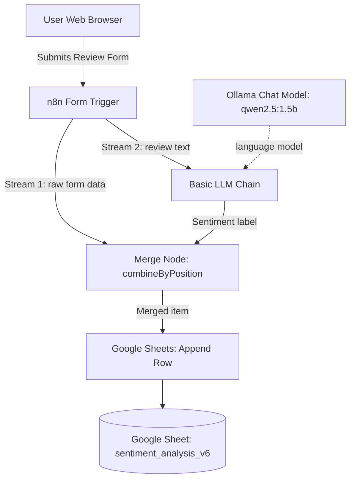

# AI-Powered Customer Review Sentiment Analysis Pipeline

An event-driven **n8n** workflow that ingests customer reviews through a web form, classifies sentiment with a locally hosted open-source LLM (`qwen2.5:1.5b` via **Ollama**), merges the result with the original submission, and appends it to a **Google Sheets** ledger.

**Category:** AI & Automation / Sentiment Analysis & Data Ingestion Workflows

---

## Table of Contents

1. [Project Overview](#1-project-overview)
2. [Problem Statement](#2-problem-statement)
3. [Proposed Solution](#3-proposed-solution)
4. [System Architecture](#4-system-architecture)
5. [Technologies & Tools](#5-technologies--tools)
6. [Workflow Execution](#6-workflow-execution)
7. [Core Features](#7-core-features)
8. [AI Implementation](#8-ai-implementation)
9. [Data Flow](#9-data-flow)
10. [Error Handling & Validation](#10-error-handling--validation)
11. [Challenges & Technical Solutions](#11-challenges--technical-solutions)
12. [Business Value](#12-business-value)
13. [Limitations & Future Improvements](#13-limitations--future-improvements)
14. [Technical Project Summary](#14-technical-project-summary)
15. [Setup & Deployment](#15-setup--deployment)

---

## 1. Project Overview

| Item | Details |
|------|---------|
| **Project Name** | AI-Powered Customer Review Sentiment Analysis Pipeline |
| **Category** | AI & Automation / Sentiment Analysis & Data Ingestion Workflows |
| **Description** | An event-driven n8n workflow that ingests customer review submissions via a web form, runs the review text through a local open-source LLM (`qwen2.5:1.5b` via Ollama) to classify sentiment, merges the structured output, and appends the result to a Google Sheets ledger. |
| **Main Purpose** | Automate customer feedback classification and centralization, replacing manual review evaluation with real-time AI sentiment tagging that runs on your own infrastructure. |
| **Target Users** | E-commerce platforms, service providers, product teams, and customer success departments needing automated, self-hosted sentiment analytics. |

---

## 2. Problem Statement

Businesses receiving high volumes of customer feedback face delays in identifying dissatisfied customers or tracking overall sentiment trends. Manual review analysis is slow, subjective, and labor-intensive. Cloud-based LLM APIs (e.g., OpenAI, Anthropic) incur ongoing per-token costs and raise data privacy concerns when handling sensitive user submissions.

---

## 3. Proposed Solution

The workflow hosts a native, user-facing review form ("Review"). On submission, n8n splits execution into a parallel enrichment pipeline:

1. **Form Ingestion:** Captures the `Your Name` and `Your Review` fields.
2. **Local AI Inference:** Passes the review text to a LangChain Basic LLM Chain backed by a local Ollama instance running `qwen2.5:1.5b`. The model classifies sentiment into exactly one label: `Positive`, `Negative`, or `Neutral`.
3. **Data Merging & Ingestion:** Combines the original form data with the LLM output by item position using a Merge node, then appends the record to a Google Sheet (`sentiment_analysis_v6`).

---

## 4. System Architecture

### Overview

The workflow uses a hybrid parallel-and-merge architecture with local AI integration:

- **Trigger Node:** `n8n-nodes-base.formTrigger` (v2.6) listening on `/<form-path>`.
- **AI Orchestration Layer:** `@n8n/n8n-nodes-langchain.chainLlm` (v1.9) connected to `@n8n/n8n-nodes-langchain.lmChatOllama` (v1).
- **Data Integration Layer:** `n8n-nodes-base.merge` (v3.2) set to `combineByPosition`.
- **Persistence Layer:** `n8n-nodes-base.googleSheets` (v4.7) authenticated via OAuth2.

### Workflow Diagram



### ASCII View

```text
+-------------------------------------------------+
|               User Web Browser                  |
|     Submits Review Form ("Your Name", "Review") |
+-------------------------------------------------+
                        |
                        v
+-------------------------------------------------+
|            n8n Form Trigger Node                |
|           ("On form submission")                |
+-------------------------------------------------+
         |                                |
         | (Stream 1: Raw Data)           | (Stream 2: Prompt Input)
         v                                v
+-------------------+           +-----------------------------------+
|                   |           |         Basic LLM Chain           |
|                   |           |  System: Classify Sentiment       |
|                   |           |  Prompt: ={{ $json['Your Review'] }}|
|    Merge Node     |           +-----------------------------------+
| (combineByPosition)                             |
|                   |                             | Sub-chain Connection
|                   |                             v
|                   |           +-----------------------------------+
|                   |           |        Ollama Chat Model          |
|                   |           |         (qwen2.5:1.5b)            |
|                   |           +-----------------------------------+
|                   |                             |
|                   |                             | Output: Sentiment Label
|                   |<----------------------------+
+-------------------+
          |
          v Merged Data Stream
+-------------------------------------------------+
|            Google Sheets Node                   |
|        (Append Row in "Sheet1")                 |
|   Columns: Name <- Name, Review <- LLM Text     |
+-------------------------------------------------+
          |
          v
+-------------------------------------------------+
|             Google Sheets Cloud                 |
|       (Document: sentiment_analysis_v6)         |
+-------------------------------------------------+
```

---

## 5. Technologies & Tools

| Technology | Role in Project | Why Used (Implementation Evidence) |
|------------|-----------------|------------------------------------|
| **n8n** | Workflow orchestrator | Connects web triggers, LangChain components, parallel data streams, and external APIs. |
| **n8n Form Trigger** | Data collection interface | Provides an embedded web form for review entry without external front-end code. |
| **LangChain LLM Chain** | AI execution framework | Handles system prompt instructions, input mapping, and response parsing. |
| **Ollama (`qwen2.5:1.5b`)** | Local LLM engine | Provides zero-cost, locally hosted AI sentiment classification. |
| **n8n Merge Node** | Data synchronization | Combines raw form inputs with AI classification results by position before the database append. |
| **Google Sheets API** | Persistent storage sink | Appends structured output into spreadsheet ID `<spreadsheet-id>`. |

---

## 6. Workflow Execution

```text
[ Form Submission ] ─────────┬───────────────────────► [ Merge Node (Input 1) ] ──┐
                             │                                                    │
                             └─► [ Basic LLM Chain ] ──► [ Merge Node (Input 2) ] ┴─► [ Google Sheets Node ]
                                        ▲
                                        │
                               [ Ollama (qwen2.5) ]
```

### Step 1: Form Ingestion

- **Component:** `n8n-nodes-base.formTrigger` (On form submission)
- **Operation:** Listens for HTTP POST form submissions.
- **Fields:**
  - `Your Name` (text, required)
  - `Your Review` (text, required)
- **Output:**

  ```json
  {
    "Your Name": "Jane Doe",
    "Your Review": "The product arrived on time and works great!"
  }
  ```

- **Necessity:** Entry point for receiving raw customer feedback.

### Step 2A: Parallel Stream A, Raw Data Routing

- **Destination:** Merge node (Input 1).
- **Operation:** Passes the raw form items straight to the merge stage to preserve customer metadata.

### Step 2B: Parallel Stream B, AI Sentiment Analysis

- **Components:** `@n8n/n8n-nodes-langchain.chainLlm` (Basic LLM Chain) with `@n8n/n8n-nodes-langchain.lmChatOllama` (Ollama Chat Model).
- **Model:** `qwen2.5:1.5b` via the local Ollama API.
- **System prompt:**

  > You are an expert in sentiment analysis. When I give you a customer review, classify its overall sentiment and reply with exactly one word: "Positive", "Negative", or "Neutral". Do not add any extra text or explanation, just the single label.

- **User input:** `={{ $json['Your Review'] }}`
- **Output:**

  ```json
  {
    "text": "Positive"
  }
  ```

- **Necessity:** Extracts a categorical sentiment from unstructured natural language text.

### Step 3: Stream Synchronization & Merging

- **Component:** `n8n-nodes-base.merge`
- **Mode:** `combine` (`combineByPosition`)
- **Operation:** Joins item 0 from Stream A (form) with item 0 from Stream B (LLM) into a single JSON item.
- **Output:**

  ```json
  {
    "Your Name": "Jane Doe",
    "Your Review": "The product arrived on time and works great!",
    "text": "Positive"
  }
  ```

### Step 4: Ledger Persistence

- **Component:** `n8n-nodes-base.googleSheets` (Append row in sheet)
- **Target document:** `sentiment_analysis_v6` (`Sheet1`).
- **Column mapping:**

  | Sheet Column | Mapped Expression | Contents |
  |--------------|-------------------|----------|
  | `Name` | `={{ $json['Your Name'] }}` | Customer name |
  | `Review` | `={{ $json.text }}` | Classification result: `Positive`, `Negative`, or `Neutral` |

- **Necessity:** Persists customer data and sentiment classifications into a central reporting system.

---

## 7. Core Features

- **Local AI Inference:** Uses a local Ollama instance (`qwen2.5:1.5b`), so review text is never sent to a third-party LLM API.
- **Strict Output Formatting:** Asks for single-word categorization (`Positive`, `Negative`, `Neutral`) through prompt design.
- **Parallel Execution Streams:** Merges the initial form payload with the LLM chain output.
- **Automated Data Centralization:** Maps sentiment results into a central Google Sheet.

---

## 8. AI Implementation

| Aspect | Details |
|--------|---------|
| **AI Model** | `qwen2.5:1.5b` running locally via Ollama |
| **Responsibility** | Text classification and sentiment evaluation |
| **Prompt Strategy** | Zero-shot system prompt with explicit constraints that restrict output to one of three labels (`Positive`, `Negative`, `Neutral`) |
| **Context Management** | Stateless single-turn completion (no conversational memory) |
| **Known Limitations** | Lightweight 1.5B models may add extra punctuation or misread complex sarcasm compared to larger models. |

---

## 9. Data Flow

```text
[ Web Form Submission ]
        │
        ├───► [ Direct Stream ] ─────────────────────────┐
        │                                                │
        └───► [ LLM Chain Prompt Ingestion ]             │
                     │                                   │
                     ▼                                   │
              [ Ollama Model ]                           │
                     │                                   │
                     ▼                                   │
              [ "Positive" ]                             │
                     │                                   │
                     └───────────────► [ Merge Node ] ◄──┘
                                             │
                                             ▼
                                  [ Google Sheets Append ]
                                   • Name:   User Name
                                   • Review: Sentiment Label
```

---

## 10. Error Handling & Validation

- **Form Validation:** Both `Your Name` and `Your Review` enforce `requiredField: true` at the UI level.
- **Type Conversion:** `attemptToConvertTypes` and `convertFieldsToString` are `false` in the Google Sheets configuration, preserving raw string output.
- **Deduplication:** Not implemented. Every submission creates a new row.
- **Fallback Mechanisms:** Standard n8n node error handling (the workflow halts if the Ollama server is unreachable or Google authentication fails).

---

## 11. Challenges & Technical Solutions

| Challenge | Solution |
|-----------|----------|
| Passing both the original form metadata (`Your Name`) and the LLM output to Google Sheets, because the LLM chain node drops incoming payload keys. | Used a Merge node in `combineByPosition` mode, running the LLM in parallel with a direct pass-through branch. |
| Getting a clean categorical string from the LLM, without conversational filler. | Wrote a system prompt instructing the model to reply only with `Positive`, `Negative`, or `Neutral`. |

---

## 12. Business Value

- **Zero Inference Costs:** Running `qwen2.5:1.5b` via local Ollama removes third-party LLM API fees.
- **Data Privacy:** Review text is analyzed on your own infrastructure instead of a public LLM API. (Submitted names and labels are still written to Google Sheets.)
- **Automated Triage:** Immediate sentiment tagging speeds up review monitoring and customer service response.

---

## 13. Limitations & Future Improvements

### Current Limitations

- **Original Review Text Not Stored:** The `Review` column receives `$json.text` (the LLM label), so the original review body is not saved to the sheet.
- **Model Capacity:** The 1.5B model may struggle with multilingual reviews, heavy slang, or sarcasm.
- **Prompt Injection:** Does not sanitize or defend against prompt injection embedded in reviews.
- **Merge Alignment:** `combineByPosition` assumes both streams return one item each, in the same order.

### Planned Enhancements

- [ ] **Sheet schema change:** Add a dedicated `Sentiment` column so the original review and the label are stored side by side.
- [ ] **Automated alerting:** Add an `If` node after classification to route `Negative` reviews to a Slack or Telegram support channel.
- [ ] **Model upgrade:** Try larger local models (e.g., `qwen2.5:7b` or `llama3.1:8b`) for better accuracy.

---

## 14. Technical Project Summary

An event-driven n8n workflow combining a native web form trigger, a local LLM chain (`qwen2.5:1.5b` via Ollama), and Google Sheets persistence. It ingests user reviews, performs local sentiment classification, merges the metadata and AI streams with an n8n Merge node, and appends structured records to a central cloud ledger.

---

## 15. Setup & Deployment

### Prerequisites

Make sure Ollama is running locally and the model is pulled:

```bash
ollama pull qwen2.5:1.5b
```

### Deployment Steps

1. Import `Sentiment_Analysis_v6.json` into your n8n workspace.
2. Configure your Ollama credentials in n8n (default host: `http://localhost:11434`).
3. Authenticate your Google Sheets OAuth2 credentials and select your destination spreadsheet.
4. Make sure the sheet has `Name` and `Review` column headers.
5. Activate the workflow and share the generated form URL.

> **Note:** If n8n runs in Docker, `localhost` points to the container, not your machine. Use `http://host.docker.internal:11434` (or your Ollama container's hostname) instead.

### Tech Stack

- **Orchestration:** n8n Workflow Engine
- **AI Framework:** LangChain integration (`@n8n/n8n-nodes-langchain`)
- **LLM Engine:** Ollama (`qwen2.5:1.5b`)
- **Data Persistence:** Google Sheets API
